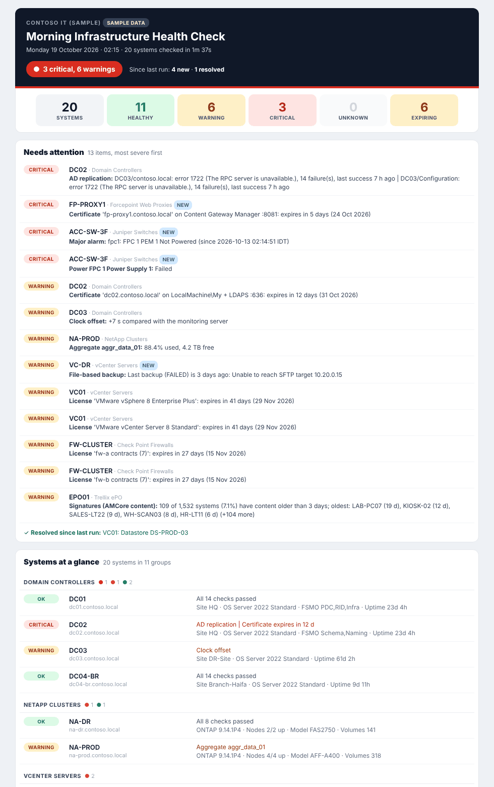

# Morning Infrastructure Health Check

A PowerShell 7 script that checks your infrastructure every morning and e-mails one colour-coded report
through Exchange, designed to be read in Gmail in under a minute.

For each system it checks:

* **Functionality**: is it up and doing its job (not just "does it ping").
* **Certificates**: validity, days left, issuer and friendly name.
* **Licenses / subscriptions**: status and expiry date.



The e-mail shows the overall state at the top (subject line, status pill, counters), then a
**Needs attention** list with the most severe items first. Items that are new since the previous run are
marked **NEW**, and items that cleared since then are listed as **Resolved**. Below that are one line per
system, the certificates and licenses that expire soon, and the complete report attached as HTML.

Run `.\Invoke-MorningHealthCheck.ps1 -Demo -NoEmail -Open` to see the report with sample data.

---

## What is checked

| System (Type) | Functionality | Certificates | License | How |
|---|---|---|---|---|
| **Domain controllers** (`DomainController`) | AD ports, LDAP / LDAPS / Global Catalog bind, RootDSE `isSynchronized`, clock offset, SYSVOL + NETLOGON, DNS (domain A + DC SRV records), inbound replication (per partner and partition), AD services, disk space, uptime, FSMO roles, site | Certificate served on LDAPS 636, and every certificate in `LocalMachine\My` (friendly name, issuer, template). Expired certificates that were already renewed are marked *superseded* instead of raising an alarm. | Windows activation (state, KMS/MAK/AVMA channel, expiry, failing KMS renewal) | LDAP, SMB, DNS, AD module, CIM/WinRM |
| **NetApp** (`NetApp`) | Nodes up, storage failover, controller fans/PSU/temperature, health alerts, aggregate and volume usage, offline volumes, failed disks, LIFs down or not home, SnapMirror health and lag, cluster peers | All server/client certificates on the cluster (ONTAP name = friendly name), and the certificate served by the management LIF | License packages: compliance and expiry | ONTAP REST API (9.6+) |
| **vCenter** (`VCenter`) | Appliance health (system, database, storage, memory, load, swap), vCenter services, ESXi connection state, datastore usage, last file-based backup | Machine SSL certificate and STS (SSO) signing certificate | All license keys: usage, over-allocation, evaluation mode, expiry | vSphere REST API (7.0 U2+), vSphere SOAP API for licenses |
| **Forcepoint web proxy** (`ForcepointProxy`) | Real browsing test through the proxy, optional "is a blocked URL really blocked" test, optional SSL-inspection test | Content Gateway Manager certificate, and the SSL-inspection CA that users actually receive | Subscription date from the config (*) | HTTP through the proxy |
| **Forcepoint management** (`ForcepointManager`) | Security Manager console, Websense/Forcepoint Windows services, disk space | Console certificate (9443), optional `LocalMachine\My` | Subscription date from the config (*) | HTTPS, CIM/WinRM |
| **Portnox CORE** (`Portnox`) | Web console, Portnox services, disk space, optional real RADIUS authentication test | Console certificate and `LocalMachine\My` (includes the RADIUS/EAP certificate) | License date from the config (*) | HTTPS, RADIUS, CIM/WinRM |
| **Juniper switches** (`Juniper`) | Chassis and system alarms, PSU/fan/temperature, Virtual Chassis members, file-system usage, overnight configuration commits | Junos PKI local certificates (certificate identifier = friendly name), optional J-Web certificate | `show system license`: features used without a license, expiring licenses | SSH (Posh-SSH) |
| **Check Point cluster** (`CheckPoint`) | Management API, ClusterXL member states and PNOTEs, installed policy and install time, disk usage, optional management-server processes | Management server and each member's Gaia portal certificate | `cplic print` on every member: license expiry and service contracts (blade subscriptions) | Management API (R80.10+) and `run-script` |
| **Trellix SIEM** (`TrellixESM`) | REST API login, ESM clock, unacknowledged alarms of the last 24 h | Console certificate | Support/subscription date from the config (*) | ESM API v2 |
| **Trellix ePO** (`TrellixEPO`) | Web API, managed systems not seen for N days, **signatures up to date**: share of systems with AMCore/DAT content older than N days (oldest named), newest content in use, content in the master repository still changing (see below). Also your own saved queries with thresholds, ePO services, disk space | Console (8443) and agent-handler (443) certificates | Subscription date from the config (*) | ePO Web API, CIM/WinRM |
| **Trellix EDR** (`TrellixEDR`) | Console reachable and responding (on-prem or SaaS URL) | Console certificate | Subscription date from the config (*) | HTTPS |
| Anything else (`WindowsServer`, `WebService`) | Services, disks, activation / URL, status code, keyword | Store / served certificate | Windows activation / from config | CIM/WinRM, HTTPS |

(*) These products do not expose license expiry through an API. Put the date in the config once a year;
the report then warns you 60 and 14 days ahead like any other license.

---

## Requirements

* A domain-joined **Windows** management server (the password encryption uses Windows DPAPI).
* **PowerShell 7.4 or later**: `winget install Microsoft.PowerShell`, or the MSI from Microsoft. It installs next to Windows PowerShell 5.1.
* **RSAT Active Directory module** for the DC checks: `Install-WindowsFeature RSAT-AD-PowerShell` (server) or
  `Add-WindowsCapability -Online -Name Rsat.ActiveDirectory.DS-LDS.Tools~~~~0.0.1.0` (client).
* **Posh-SSH** for the Juniper checks: `Install-Module Posh-SSH -Scope AllUsers`.
* Network access from the management server:

| To | Ports |
|---|---|
| Domain controllers | TCP 53, 88, 135, 389, 445, 636, 3268, 5985 (WinRM), 9389 (AD Web Services) |
| NetApp cluster management LIF, vCenter, Check Point management, ESM | TCP 443 |
| Check Point members (optional portal certificate) | TCP 443 (or 4434) |
| ePO | TCP 8443, 443, 5985 |
| Forcepoint | proxy port (8080), 8081, 9443, 5985 to the manager |
| Portnox | TCP 443, 5985, UDP 1812 for the RADIUS test |
| Juniper switches | TCP 22 |
| Exchange | TCP 25 (relay) or 587 (authenticated) |

ICMP is optional (`Ping = $false` per target). If a host answers on TCP but not ping, that is shown as a note, not a warning.

---

## Setup

### 1. Copy the folder

Copy the `MorningHealthCheck` folder to the management server, for example `C:\Scripts\MorningHealthCheck`.
If you downloaded it as a ZIP, unblock the files first: `Get-ChildItem C:\Scripts\MorningHealthCheck -Recurse | Unblock-File`.

### 2. Create a service account

Use a dedicated account, for example `CONTOSO\svc-healthcheck`, with these rights:

| System | What the account needs |
|---|---|
| Domain controllers | LDAP, replication metadata, SYSVOL and DNS work as any domain user. Services, disks, Windows activation and the certificate store are read through WinRM/CIM: that needs local administrator rights on the DCs, *or* membership of *Remote Management Users* plus "Remote Enable" on WMI `root\cimv2` and service-control-manager read access. Anything the account cannot read shows as **Unknown** with the reason. If you give it administrator rights on DCs, treat the account and the management server as Tier 0. |
| NetApp | `security login create -user-or-group-name svc_healthcheck -application http -authentication-method password -role readonly` |
| vCenter | SSO user with the global **Read-only** role. Appliance health and file-based backup status come from the appliance (VAMI) API and may need an account with appliance rights; without them those two rows show *Unknown*. |
| Check Point | Administrator with a read-only permission profile that also allows **Run One Time Script** (needed for `run-script`). An API key works too: store it with user name `api-key`. |
| Juniper | `set system login user svc-healthcheck class read-only` |
| Trellix ePO | ePO user that can view the System Tree, product properties and the master repository, and run the saved queries you list (share them with the user). |
| Trellix ESM | ESM user with read-only rights and API access. |
| Forcepoint proxy | Allowed to browse the test URLs (the check authenticates as the task account when `UseDefaultCredentials = $true`). |
| Portnox (RADIUS test) | Add the management server as a RADIUS client in Portnox and store the shared secret (see the config). |

### 3. Create the configuration

```powershell
Copy-Item .\config\HealthCheck.config.example.psd1 .\config\HealthCheck.config.psd1
notepad .\config\HealthCheck.config.psd1
```

The example is fully commented: e-mail settings, thresholds, per-type defaults and one entry per system.
Domain controllers can be discovered automatically (`Discover = 'contoso.local'`). The real config file is
excluded from git by `.gitignore`, so your inventory never lands in the repository.

### 4. Store the passwords (encrypted)

Run this **as the service account** on the management server:

```powershell
runas /user:CONTOSO\svc-healthcheck "pwsh -NoProfile -File C:\Scripts\MorningHealthCheck\Set-HealthCheckCredential.ps1 -Missing"
```

`-Missing` prompts for every credential the config refers to that is not stored yet. Other options:

```powershell
.\Set-HealthCheckCredential.ps1 -Name netapp -UserName svc_healthcheck   # add or replace one credential
.\Set-HealthCheckCredential.ps1 -Name checkpoint -UserName api-key       # API key goes in the password field
.\Set-HealthCheckCredential.ps1 -List                                    # names, users, readable yes/no (no secrets shown)
.\Set-HealthCheckCredential.ps1 -Remove netapp
```

### 5. Preview the e-mail in Gmail

```powershell
.\Invoke-MorningHealthCheck.ps1 -Demo -To your.name@gmail.com
```

This sends the sample report through your Exchange settings, so you can check delivery and formatting
before configuring anything else.

### 6. First real run

```powershell
.\Invoke-MorningHealthCheck.ps1 -NoEmail -Open                    # all systems, open the report in the browser
.\Invoke-MorningHealthCheck.ps1 -Only NetApp -Sequential -NoEmail -Open -Verbose   # one type at a time
```

Go through the systems one type at a time and look at every **Unknown** row. Those usually mean a missing
permission, a closed port or an API that differs on your version. The reason is in the row and in `Logs\`.

### 7. Schedule it

```powershell
# elevated PowerShell 7
.\Register-HealthCheckTask.ps1 -RunAs CONTOSO\svc-healthcheck -At 06:30            # daily
.\Register-HealthCheckTask.ps1 -RunAs CONTOSO\svc-healthcheck -At 06:30 -WeekdaysOnly
Start-ScheduledTask -TaskName 'Morning Health Check'                               # test now
```

The account needs the *Log on as a batch job* right on the management server.

---

## How the passwords are protected

* The config contains only credential **names**, never passwords.
* `Set-HealthCheckCredential.ps1` saves each credential as `Credentials\<name>.cred.xml`. The password is
  encrypted with **Windows DPAPI** for the account that ran the script, on that computer. Copying the file
  to another machine, or reading it as another user, does not decrypt it.
* The `Credentials` folder is created with inheritance disabled: only that account, SYSTEM and local
  Administrators have access.
* Passwords are decrypted in memory only when the check runs. They are never written to logs or reports.
* On non-Windows systems the script refuses to save credentials, because the file would not be encrypted there.
* Limits: like any DPAPI secret, the passwords can be recovered by someone who can log on as the service
  account on that server, or who has full administrative control of the server. Protect both accordingly.
* To change a password, run `Set-HealthCheckCredential.ps1 -Name <name>` again as the service account.

---

## Getting the e-mail from Exchange to Gmail

**Option A: anonymous relay (port 25).** On Exchange, allow only the management server to relay:

```powershell
# Exchange Management Shell
New-ReceiveConnector -Name 'Relay - HealthCheck' -Server EXCH01 -TransportRole FrontendTransport -Custom `
    -Bindings 0.0.0.0:25 -RemoteIPRanges 10.0.0.50 -PermissionGroups AnonymousUsers
Get-ReceiveConnector 'EXCH01\Relay - HealthCheck' |
    Add-ADPermission -User 'NT AUTHORITY\ANONYMOUS LOGON' -ExtendedRights 'Ms-Exch-SMTP-Accept-Any-Recipient'
```

Config: `SmtpServer = 'exch01.contoso.local'; Port = 25; UseStartTls = $false` (or `$true` if the
connector's certificate is trusted by the management server).

**Option B: authenticated submission (port 587).** Use a mailbox account. Store it with
`Set-HealthCheckCredential.ps1 -Name smtp`, then set `Port = 587; UseStartTls = $true; Credential = 'smtp'`.
The script refuses to send credentials without TLS.

To keep Gmail from treating the report as spam:

* Send **From** a domain Exchange is authoritative for, with SPF, DKIM and DMARC published.
* In Gmail, create a filter for `from:healthcheck@contoso.com` with *Never send it to Spam* and *Always mark it as important*.

The report contains internal host names, versions and states. Make sure sending it to an external
mailbox fits your security policy. `ShowAddresses = $false` in the Email section hides host names and IPs.

---

## Reading the report

| Status | Meaning |
|---|---|
| **CRITICAL** | Broken or about to break: service down, replication failing, certificate expiring within 7 days, ... |
| **WARNING** | Needs attention soon: space running out, certificate within 30 days, license within 60 days, ... |
| **UNKNOWN** | Could not be checked: no permission, credential missing, API error. Fix these too, or you are not monitoring that system. |
| **OK** | All checks passed. |
| INFO | Shown for context only, never affects the status (for example "superseded certificate, safe to delete"). |

* **Subject line**: a red, yellow or green dot plus the counts, so the inbox list already tells you the state.
* **Since last run**: compared with the previous scheduled run. New issues are marked NEW, cleared issues are listed as resolved.
* **Changed / Policy installed** (highlighted on a system's line): a switch configuration commit or a firewall policy install in the last 24 hours.
* The e-mail lists certificates expiring within 90 days and licenses within 120 days (`CertificateDays`, `LicenseDays`).
  The **attached report** lists everything: every check, every certificate with issuer and friendly name, and every license.
* Gmail cuts off messages larger than about 102 KB. If a very large environment would exceed that, the e-mail
  switches to a compact layout (problems only) automatically. The attachment is always complete.
* Reports and logs are kept in `Reports\` and `Logs\` for `KeepDays` (30) days.

---

## Signatures in ePO (AMCore / DAT content)

Every morning the ePO check answers two questions.

**Do the managed systems have current signatures?** The check reads the content date of every system
(ENS *AMCore Content Date*). Systems with content older than `MaxAgeDays` (default 3) are out of date.
Their share of all systems that report content sets the status: `WarningPct` 5 %, `CriticalPct` 15 %.
The row names the oldest systems, for example
`109 of 1,532 systems (7.1%) have content older than 3 days; oldest: LAB-PC07 (19 d), KIOSK-02 (12 d), ...`.
For legacy VirusScan the DAT version is used instead (out of date = more than `MaxVersionsBehind` versions
behind the newest one in use).

**Is ePO itself still getting new content from Trellix?** AMCore content is released daily, so the check
warns when:
* even the newest content on *any* system is older than `RepositoryMaxAgeDays` (default 2), or
* the AMCore/DAT package in the master repository has not changed for `RepositoryMaxAgeDays`. The script
  remembers between runs when it first saw each version, so this needs a couple of daily runs to become meaningful.

Either one usually means the repository pull server task is failing, or ePO lost its route to Trellix.

The per-system data is read automatically. The check tries the ePO properties for Endpoint Security
(`AM_CustomProps.AMCoreContentDate`, then `EPOProdPropsView_THREATPREVENTION.verDAT32Major`) and then
VirusScan (`EPOProdPropsView_VIRUSCAN.datver`). If your ePO names them differently, the row shows **Unknown**.
In that case, give it a saved query instead:

1. In ePO: *Menu > Reporting > Queries & Reports > New Query*, result type **Managed Systems**, chart **Table**.
2. Columns: **System Name** and **AMCore Content Date** (Endpoint Security Threat Prevention properties). For
   VirusScan use **DAT Version**. Don't add a filter; the script works out the age itself.
3. Save the query and share it with the API user. Note its ID: it is in the query's URL, or list all
   queries with `https://<epo>:8443/remote/core.listQueries`.
4. Set `Signatures = @{ QueryId = <id> }` on the ePO target.

ePO's default *AMCore Content Compliance* query treats content up to 7 days old as compliant. Set
`MaxAgeDays = 7` if you want the report to agree with that dashboard.

---

## Configuration reference

All thresholds are in the `Thresholds` section of the config (defaults shown in the example).
Options per target type (put them on a target, or under `Defaults.<Type>` for all targets of that type):

| Option | Types | Meaning |
|---|---|---|
| `Credential` | all API types | Name of a stored credential. For `DomainController` / `WindowsServer`, omit it to use the task account. |
| `WindowsCredential` | ForcepointManager, Portnox, TrellixEPO, WebService | Credential for the Windows checks, if the task account cannot be used |
| `Ping`, `Ports`, `TlsPorts`, `TlsServerName` | all | Reachability checks, extra TLS ports to inspect, name to send as SNI |
| `SkipCertificateCheck` | API types | Accept self-signed certificates for the API call (the certificate is still reported) |
| `IgnoreCertificates` | all | Wildcards on friendly name / CN / thumbprint, reported as Info |
| `Licenses` | all | Manual license entries: `@{ Name; Expires = 'yyyy-MM-dd'; Usage; Note; WarningDays; CriticalDays }` |
| `Discover`, `Exclude`, `Services`, `OptionalServices`, `CheckLdaps`, `CheckReplication`, `CheckActivation`, `CheckCertificateStore`, `CheckShares`, `CheckDns` | DomainController | Discovery and the optional parts of the DC check |
| `CertificateTypes`, `IgnoreVolumes` | NetApp | Certificate types to read (default server, client); volumes to skip |
| `HealthComponents`, `IgnoreDatastores`, `CheckBackup`, `CheckLicenses` | VCenter | |
| `ProxyPort`, `ManagerPort`, `TestUrls`, `UseDefaultCredentials`, `BlockTestUrl`, `BlockPageKeyword`, `SslInspectionTestHost`, `SslInspectionCAName` | ForcepointProxy | |
| `ConsolePort`, `WebUrl`, `Keyword`, `ExpectedStatus`, `ServicePatterns`, `ExcludeServices` | ForcepointManager, Portnox | |
| `Radius = @{ SecretCredential; Credential; Port; ExpectAccept; Servers }` | Portnox | Real RADIUS Access-Request. Any answer proves the service works; with `ExpectAccept` the test user must be accepted. |
| `SshPort`, `KeyFile`, `HttpsPort`, `IgnoreAlarms`, `CheckEnvironment`, `CheckVirtualChassis`, `CheckStorage`, `CheckPkiCertificates` | Juniper | |
| `Members = @( @{ Name; Address; PortalPort } )`, `ManagementObjectName`, `Domain` | CheckPoint | Member names as in SmartConsole |
| `Signatures = @{ MaxAgeDays; WarningPct; CriticalPct; RepositoryMaxAgeDays; MaxVersionsBehind; QueryId; ShowOldest; CheckRepository; Enabled }` | TrellixEPO | Signature checks, see *Signatures in ePO* |
| `SavedQueries = @( @{ Id; Name; WarningAbove; CriticalAbove } )`, `CheckAgents`, `CheckSignatures` | TrellixEPO | Alerts on the number of rows a saved query returns |
| `CheckAlarms`, `AlarmWarningCount` | TrellixESM | |
| `Url`, `Keyword`, `ExpectedStatus` | TrellixEDR, WebService | |

---

## Troubleshooting

| Symptom | Fix |
|---|---|
| `Credential 'x' cannot be decrypted by ...` | The credential was saved by another account or on another computer. Re-create it as the task account. |
| `Credential 'x' has not been stored` | `Set-HealthCheckCredential.ps1 -Missing` (as the task account). |
| DC rows `Cannot connect: WinRM ...` | WinRM must be reachable (TCP 5985), and the account needs rights on the DC (see the table above). Use FQDNs, because Kerberos does not work with IP addresses. |
| `The LDAP server is unavailable` on LDAPS | With 636 open, the LDAPS certificate is usually missing, expired, untrusted, or does not match the DC name. The certificate table shows which one. |
| vCenter appliance health `Access denied` | The account lacks appliance rights. Use a more privileged SSO account or ignore the row. |
| Check Point `run-script failed` | Object name in `Members` must match SmartConsole; SIC must be working; the profile needs Run One Time Script. |
| Juniper `Posh-SSH module is not installed` | `Install-Module Posh-SSH -Scope AllUsers` |
| E-mail `5.7.1 Unable to relay` | The Exchange receive connector does not allow this server to relay (see above). |
| Nothing arrives in Gmail | Check the Gmail spam folder and the Exchange message tracking log; publish SPF/DKIM for the From domain. |
| A check runs too long | `MaxRunMinutes` stops the run; lower `ThrottleLimit` or `TimeoutSec`, or use `-Only` and `-Sequential` to find the slow system. |

Logs: `Logs\HealthCheck_<date>.log`. Exit code 0 means the run completed (whatever the findings); exit code 1
means the script itself failed, and in that case a short *FAILED to run* e-mail is sent.

---

## Testing

`pwsh -File .\tests\Test-HealthCheck.ps1` runs offline tests of the parsers (Junos, ClusterXL, `cplic`,
`fw stat`, `df`, `cpwd_admin`), date handling, status and threshold logic, HTML encoding and config validation.
No network or Pester is needed.

The vendor API calls follow the vendors' documented interfaces (ONTAP REST, vSphere Automation and Web
Services APIs, Check Point Management API, ePO Web API, ESM API v2). API details differ between versions,
so validate each type once in your environment (step 6 above) before relying on the report.

---

## Files

```
Invoke-MorningHealthCheck.ps1     main script (run by the scheduled task)
Set-HealthCheckCredential.ps1     store / list / remove encrypted credentials
Register-HealthCheckTask.ps1      create the daily scheduled task
config/                           HealthCheck.config.example.psd1 (copy to HealthCheck.config.psd1)
HealthCheck/                      PowerShell module
  Private/                        results model, network/TLS/HTTP, RADIUS, Windows, credentials, report, mail, demo data
  Checks/                         one file per system type
tests/Test-HealthCheck.ps1        offline tests
Credentials/ Reports/ Logs/       created at run time (git-ignored)
```

To add a system type, add `Checks\<Type>.ps1` with a function `Invoke-HCCheck<Type>` (use `NetApp.ps1` as a
template), then register the type and its display name in `$script:HCCategories` in `Private\Results.ps1`.
